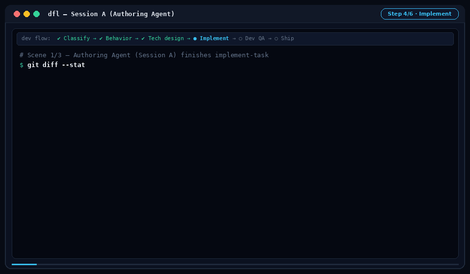
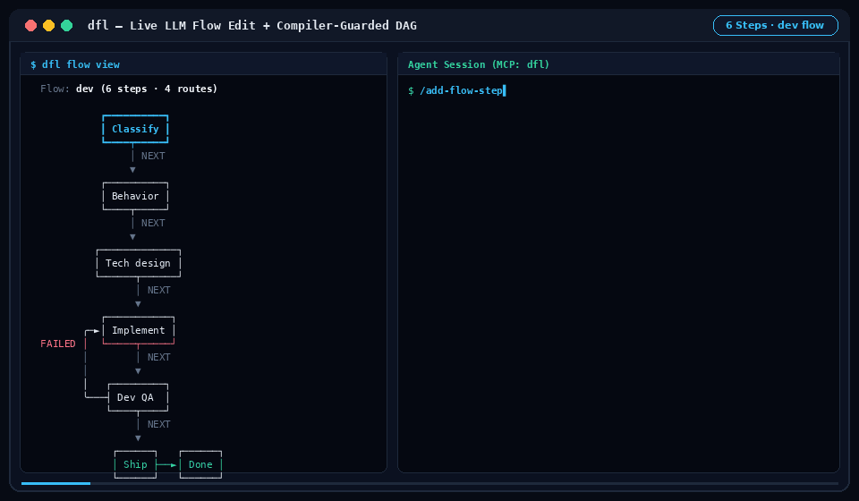

# dfl (devFlow)

**Deterministic dev workflows for coding agents — enforced by XState + MCP, audited in a fresh session, portable across 9 agents.**

[](https://github.com/vishin-pavel/dfl/actions)
[](https://www.npmjs.com/package/@vishin-pavel/dfl)
[](LICENSE)
[](package.json)

> **100% Local · Zero Telemetry · MIT Open Source**  
> Zero analytics dependencies. Zero phone-home network calls — the sole `fetch()` in the entire codebase (`src/core/tracker/http.ts`) is optional Jira Cloud sync when you explicitly configure `.df/tracker.json`.



---

## Why `dfl`?

| Vibe Coding & Markdown Prompt Packs | With `dfl (devFlow)` |
|---|---|
| Coding agent grades its own homework in a poisoned context | **`/verify-task` refuses same-session grading** (unless explicitly overridden & logged) and maps every `git diff` hunk to an accepted requirement ID |
| "AI Waterfall": 1,000 lines of spec prose for a 5-line bug | **Adaptive 4-route classification** (`full`, `behavior`, `design`, `code`) — bug fixes skip straight to `implement → verify → ship` |
| Markdown rules are suggestions LLMs silently skip | **Real XState v5 state machine over stdio MCP** — invalid transitions, unintended exits, and loops (4th visit) are blocked deterministically |
| Locked into Claude Code or one IDE fork | **One git-committed `.df/` folder → 9 coding agents** (Claude Code, Cursor, Antigravity, Codex, Gemini CLI, Copilot, Windsurf/Devin, OpenCode, Kiro) |
| Spec walls nobody reads; brittle Cucumber boilerplate | **Scannable `Given/When/Then` rules with stable IDs (`CHK-1.2`)** in Markdown — zero Cucumber runner required |
| Over-specified architecture prose or sloppy defaults | **Quality-Attribute steering (ISO/IEC 25010:2023)** — define measurable `PERF` / `SEC` / `MAINT` targets, not class names |

---

## 60-Second Quickstart

Requires **Node.js `>=22.12`** (macOS, Linux, or WSL).

```bash
# 1. Install globally (note the scoped package name)
npm install -g @vishin-pavel/dfl

# 2. Initialize the built-in dev flow and compile native skills + MCP config
dfl install --yes --agents claude,cursor

# 3. Commit the flow and MCP config on your default branch before your first task
#    (keeps the working tree clean so /verify-task does not flag .df/ as out of scope)
git add .df .mcp.json .cursor/mcp.json && git commit -m "Add dfl dev flow"

# 4. Inspect your workflow DAG directly in the terminal
dfl flow view --print --zoom 1
```

**Want to try `dfl flow view` in <30 seconds without touching your own repo?**  
Run the self-contained 1-command sandbox from [`dfl-satellite-repo`](https://github.com/vishin-pavel/dfl-satellite-repo/blob/main/demo/run-demo.sh) (`./demo/run-demo.sh`).

Once installed, open your coding agent and run:
- `/classify-task <describe your task>` — classifies scope and routes to `full`, `behavior`, `design`, or `code`
- `/fast-forward to verify-task` — bounded autopilot with fresh sub-agents per step and logged assumptions
- `/verify-task` (in a **fresh session**) — maps every `git diff` hunk to accepted requirements and verifies tests

*(OpenAI Codex invokes skills with `$name`, e.g. `$classify-task` and `$fast-forward`.)*

---

## Built-In `dev` Flow: Adaptive, Not Waterfall

`dfl` ships with one battle-tested default template: `dev` (6 steps: `classify-task`, `define-behavior`, `design-tech`, `implement-task`, `verify-task`, `ship-task`; 2 final states: `done`, `not-handled`).

`/classify-task` inspects your task and chooses the lightest route that fits:

| Route | When It Triggers | Steps Run |
|---|---|---|
| **`code`** | Bug violating an accepted scenario, chore, or refactor within existing rules | `implement-task` → `verify-task` → `ship-task` |
| **`behavior`** | Business rule / user behavior change with no architectural impact | `define-behavior` → `implement-task` → `verify-task` → `ship-task` |
| **`design`** | Architecture or quality-attribute change with unchanged user behavior | `design-tech` → `implement-task` → `verify-task` → `ship-task` |
| **`full`** | New feature or major change spanning behavior and architecture | `define-behavior` → `design-tech` → `implement-task` → `verify-task` → `ship-task` |

If `/verify-task` finds a defect, an unmapped diff hunk, a missing requirement, or an unscreened quality risk, the XState machine routes work back via `FAILED`, `REQUIREMENTS_GAP`, or `DESIGN_GAP` — never silently shipping.

### Bounded Autopilot (`/fast-forward`)

Need speed without sacrificing checkpoints? `/fast-forward [target-state]` runs steps autonomously using fresh sub-agents per step, logs every assumed decision (`Source: assumed`), stops deterministically on a loop (4th visit to any step), refuses unintended side-exit final states (`OUT_OF_SCOPE` / `not-handled`), and opens **draft PRs** without pinging reviewers.

- `/fast-forward to implement-task` — review specs before writing code
- `/fast-forward to verify-task` — run independent Dev QA yourself
- `/fast-forward to ship-task` — review the diff before pushing a PR

---

## How `dfl` Compares (Nov 2026)

| Capability | `dfl` | GitHub Spec Kit | OpenSpec | GSD | Superpowers | BMAD |
|---|---|---|---|---|---|---|
| **State Enforcement** | XState v5 + MCP | Markdown | Markdown | Markdown | Markdown | Markdown |
| **Terminal DAG Viewer** | Built-in (`Ink` + `elkjs`) | None | None | None | None | None |
| **Adaptive Anti-Waterfall Routing** | 4 routes (`code` skips specs) | Rigid phases | Fluid | Atomic plans | Fixed phases | Heavy agile |
| **Fresh-Session Diff-to-Req Audit** | Built-in (`/verify-task`) | Manual | Manual | Fresh coding | Manual | Manual |
| **Quality-Attribute Tech Design** | ISO 25010:2023 + 8 concerns | Freeform | Freeform | Freeform | Freeform | Freeform |
| **Coding Agents Supported** | 9 (`agentskills.io` + MCP) | 30+ | 30+ | 13 | 5 | Multi |
| **Zero Telemetry by Default** | Yes (0 analytics deps) | Undocumented (Issue #1274) | Opt-out default | Yes | Yes | Yes |

---

## Key Differentiators

### 1. Stop Letting Coding Agents Grade Their Own Homework (`/verify-task`)

`/verify-task` refuses to run in the same conversation that wrote the code (unless explicitly overridden and logged). In a fresh session — or even a different model or coding agent — it runs `git diff <base> HEAD`, requires **every diff hunk** to map to an accepted requirement ID (`CHK-1.2`), checks that tests cite each scenario ID, reproduces bug fixes against `<base>` in a clean `git worktree`, and never edits code itself.

### 2. Steer Architecture with Quality Attributes, Not Micromanagement (`/design-tech`)

Instead of 10 pages of prose dictating class names, `/design-tech` screens ISO/IEC 25010:2023 quality attributes (`FUNC`, `PERF`, `COMP`, `IC`, `REL`, `SEC`, `MAINT`, `FLEX`, `SAFE`) plus 8 operational concerns (`OBS`, `DEPLOY`, `CICD`, `COST`, `PRIV`, `DCONS`, `COMPL`, `DX`) into concise, measurable targets and expensive-to-reverse decisions (`DEC-n`). The agent chooses how to implement; you own the constraints.

### 3. Edit Your Workflow in Plain English — With a Compiler Guard

Run `/add-flow-step`, `/edit-flow-step`, or `/delete-flow-step` in your coding agent. Under the hood, `dfl`'s built-in stdio MCP server (15 tools, 2 resources) validates XState graph integrity and Handlebars template syntax *before* writing to disk, rewires transitions safely, and re-syncs all configured agents automatically.



### 4. Built for Brownfield Repos & Mixed-Agent Teams

- **9 coding agents from one `.df/` folder:** Renders native `agentskills.io` skills and comment-preserving JSON/JSONC/TOML MCP configs for **Claude Code**, **Cursor**, **Google Antigravity**, **OpenAI Codex**, **Gemini CLI**, **GitHub Copilot**, **Windsurf / Devin**, **OpenCode**, and **Kiro** — without modifying your root `.gitignore` or overwriting hand-written skills.
- **Brownfield-first adoption:** Baseline only the behavior each task touches, with explicit human confirmation so legacy bugs are never codified as requirements.
- **4-tier Handlebars variables:** Commit shared team defaults in `.df/config.json`, keep personal preferences (`featureBranchPrefix`, `reviewer`) in gitignored `.df/local.json`, and expose only `DFL_ENV_*` allow-listed environment variables to templates.
- **Optional Jira Cloud handoff:** Stores exact flow state in a hidden Jira issue entity property (`dfl.run`) so teammates checking out the same branch resume at the exact same step.

---

## Interactive Terminal DAG Viewer (`dfl flow view`)

Inspect your entire XState workflow without leaving the terminal. `dfl flow view` uses `Ink` + `elkjs` (1 ELK unit = 1 terminal cell) with orthogonal edge routing, 4 zoom levels (`0` compact one-liners to `3` full cards with skill invocation commands), pan (`wasd` / arrows), top-to-bottom / left-to-right toggle (`l`), center on current step (`c`), and non-interactive `--print`, `--lr`, and `--ascii` flags for CI logs or docs.

```text
  [classify-task] ──OUT_OF_SCOPE──► (not-handled)
    │    │    │
    │    │    └─CODE_ONLY───────────────────────┐
    │    └─TECH_ONLY───────────┐                │
    ▼ NEXT                     ▼                ▼
  [define-behavior] ──NEXT──► [design-tech] ──► [implement-task]
    ▲                           ▲                │   ▲
    │ REQUIREMENTS_GAP          │ DESIGN_GAP     ▼   │ FAILED / CHANGES_REQUESTED
    └───────────────────────────┴────────────── [verify-task] ──NEXT──► [ship-task] ──NEXT──► (done)
```

```bash
# Interactive TUI viewer
dfl flow view

# Non-interactive snapshot for terminals, PRs, or CI logs
dfl flow view --print --zoom 1
dfl flow view --print --lr --ascii
```

---

## Built-In Skills & Local Stdio MCP Server

Every `dfl install` wires up a local stdio MCP server (`dfl mcp`) and renders built-in utility skills alongside your flow's step skills:

- **4 always-installed built-in skills:**
  - `/add-flow-step` — add a step to `.df/<flow>/flow.json` and scaffold its `SKILL.md.hbs`
  - `/edit-flow-step` — update a step's transitions, title, or Handlebars template
  - `/delete-flow-step` — remove a step and rewire transitions cleanly
  - `/fast-forward` — run bounded autopilot to a target state or `done`
- **1 optional built-in skill:** `/init-task` (automatically rendered when `.df/tracker.json` is configured for Jira Cloud).
- **Stdio MCP server (`dfl mcp`):** Exposes **15 tools** (`get_flow`, `list_flows`, `get_status`, `get_step`, `validate_flow`, `get_authoring_guide`, `transition`, `complete_step`, `goto_step`, `start_task`, `fast_forward`, `add_step`, `update_step`, `delete_step`, `sync`) and **2 resources** (`dfl://flow`, `dfl://steps/{id}`), protected by a project lock (`.df/.lock`).

---

## 4-Tier Variables & Git-Clean Ownership

Share one workflow across your entire team while letting each developer keep personal preferences out of git:

| Layer | File / Source | Committed? | Purpose |
|---|---|---|---|
| **1. Flow defaults** | `.df/<flow>/flow.json` | Yes | Baseline template defaults (`testCommand`, `sensitivePaths`) |
| **2. Project config** | `.df/config.json` | Yes | Repo-wide variable overrides and selected agents |
| **3. Personal config** | `.df/local.json` | No (gitignored) | Developer-local vars (`featureBranchPrefix`, `reviewer`) |
| **4. Environment** | `DFL_VAR_*` / `DFL_ENV_*` | No | Runtime overrides; only `DFL_ENV_*` is allow-listed into templates |

`dfl` never modifies your root `.gitignore` and never overwrites hand-written skills. Each installed skill directory carries a self-ignoring `.gitignore` marker (`*`) and `metadata.dfl-*` frontmatter tracked in `.df/installed.json`.

---

## Sharing Flows & Optional Jira Cloud Sync

- **Share workflows across repos:** Import any flow via `dfl flow import github:<owner>/<repo>` (or a git URL, local directory, or `.dfl.json` snapshot). `dfl flow pull` previews per-file digest diffs and creates automatic backups in `.df/.dfl-backups/`.
- **Optional Jira Cloud handoff:** Configure `.df/tracker.json` to bind branches to Jira issues. `dfl` stores exact flow state in a hidden Jira issue entity property (`dfl.run`) — no Jira admin or custom workflow field required — and keeps personal classic API tokens strictly in `~/.config/dfl/credentials.json` (mode `0600`), never in your repo.

---

## Supported Coding Agents

| Agent | CLI ID | Skills Directory | Invocation | Project MCP Config |
|---|---|---|---|---|
| **Claude Code** | `claude` | `.claude/skills` | `/name` | `.mcp.json` |
| **Cursor** | `cursor` | `.cursor/skills` | `/name` | `.cursor/mcp.json` |
| **Google Antigravity** | `antigravity` | `.agents/skills` | `/name` | `.agents/mcp_config.json` |
| **OpenAI Codex** | `codex` | `.agents/skills` | `$name` | `.codex/config.toml` |
| **Gemini CLI** | `gemini` | `.gemini/skills` | `/name` | `.gemini/settings.json` |
| **GitHub Copilot** | `copilot` | `.github/skills` | `/name` | `.mcp.json` |
| **Windsurf / Devin** | `windsurf` | `.devin/skills` | `/name` | `.devin/mcp_config.json` |
| **OpenCode** | `opencode` | `.opencode/skills` | `/name` | `opencode.json` / `.jsonc` |
| **Kiro** | `kiro` | `.kiro/skills` | `/name` | `.kiro/settings/mcp.json` |

---

## Honest Trade-Offs & Limitations

We believe senior engineers deserve upfront clarity before installing a workflow tool:

1. **Inside-step LLM compliance is prompt-enforced, not OS-sandboxed:** XState v5 and the stdio MCP server deterministically enforce state transitions, `/fast-forward` loop limits (4th visit), and refusal of unintended final states. Inside an individual step (e.g., mapping every diff hunk), compliance relies on structured skill protocols and git auditability.
2. **Documentation-only Gherkin:** `REQUIREMENTS.md` uses declarative `Given/When/Then` Markdown linked to tests by stable IDs (`CHK-1.2`), not executable Cucumber `.feature` step definitions.
3. **Node.js `>=22.12` required:** Runtime requires Node.js `>=22.12` (building from source requires `>=22.18` or `>=24.11`).
4. **Platform support:** Tested in CI on macOS and Linux; WSL works like Linux. Native Windows MCP currently requires a small `.df/config.json` `.cmd` shim override (see [MCP Server docs](https://github.com/vishin-pavel/dfl/blob/main/docs/mcp-server.md)).
5. **Fixed 9 built-in agent adapters:** Supports the 9 agents above out of the box; custom user-declared agent adapters are not yet supported.
6. **Jira Cloud classic API tokens only:** Optional external tracker sync supports Jira Cloud with classic API tokens today (no GitHub Issues, Linear, Jira Server/Data Center, or scoped Atlassian tokens yet).
7. **`elkjs` dependency license:** The terminal DAG layout engine `elkjs` is licensed under `EPL-2.0 OR GPL-3.0-or-later`; it is dynamically imported unmodified at runtime and kept external from the bundle (see [`NOTICE`](NOTICE)).

---

## Essential CLI Commands

```bash
# Setup & agent synchronization
dfl install --yes --agents claude,cursor   # Initialize dev flow + sync skills & MCP configs
dfl flow-update                            # Re-render skills after editing .df/ or variables
dfl agents                                 # List all 9 built-in coding agent adapters

# Runtime flow inspection & navigation
dfl status                                 # Show current step, branch, and fast-forward state
dfl flow view                              # Open interactive Ink + ELKjs terminal DAG viewer
dfl flow validate                          # Validate XState graph + Handlebars templates
dfl fast-forward verify-task               # Start bounded autopilot up to verify-task

# Sharing flows & optional Jira tracking
dfl flow import github:owner/repo          # Import a shared .df/ flow from GitHub or git URL
dfl flow pull                              # Preview digest diffs and safely update imported flow
dfl task start PROJ-123                    # Bind a branch & Jira Cloud issue to the active flow
```

All commands support `--json` and `--yes` for non-interactive CI/scripting, plus `DFL_*` environment overrides.

---

## Documentation Hub

- [Built-In `dev` Flow & `/fast-forward` Guide](https://github.com/vishin-pavel/dfl/blob/main/docs/dev-flow.md) — 6 steps, 4 adaptive routes, brownfield adoption, and autopilot safety rails
- [Variables, Handlebars Templates & Custom Flows](https://github.com/vishin-pavel/dfl/blob/main/docs/variables-and-templates.md) — `.df/` layout, 4-tier variables, `flow import`/`pull`, and skill authoring
- [MCP Server & Authoring Tools](https://github.com/vishin-pavel/dfl/blob/main/docs/mcp-server.md) — 15 stdio MCP tools, 2 resources, project locking, and native Windows shim config
- [Jira Cloud State Sync](https://github.com/vishin-pavel/dfl/blob/main/docs/jira.md) — `.df/tracker.json`, hidden `dfl.run` properties, branch templates, and credential storage
- [Full CLI Reference](https://github.com/vishin-pavel/dfl/blob/main/docs/cli-reference.md) — every subcommand, `--json` / `--yes` CI flags, and `DFL_*` environment variables
- [Agent Compatibility Matrix](https://github.com/vishin-pavel/dfl/blob/main/docs/AGENTS.md) · [Architecture](https://github.com/vishin-pavel/dfl/blob/main/docs/ARCHITECTURE.md) · [Security & Zero-Telemetry Policy](https://github.com/vishin-pavel/dfl/blob/main/SECURITY.md) · [Contributing](https://github.com/vishin-pavel/dfl/blob/main/CONTRIBUTING.md) · [Third-Party Notices](NOTICE) · [License (MIT)](LICENSE)
