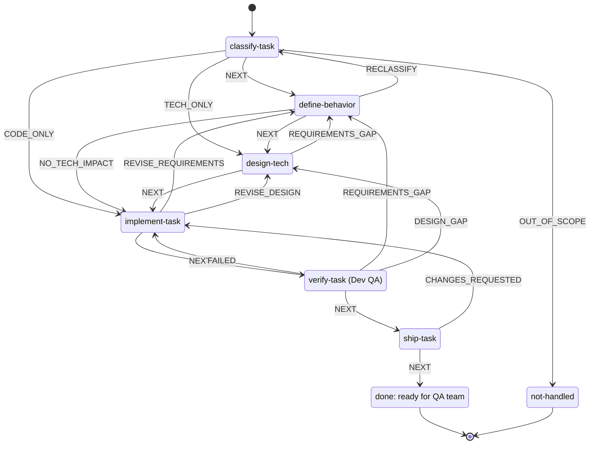

# Review: requirements-driven default flow

Status: review of 2026-10-07 of the owner's hand-drawn "DEV flow SKILLs" schema; the owner's decisions are recorded in §9 (accepted 2026-10-07). Produced by six lens reviewers (engine fit, classification, behavioral requirements, tech design, implementation and QA, migration), with every codebase claim adversarially verified, then synthesized and checked for completeness against the owner's requirements.

## 1. Verdict

The process is sound, and it suits dfl better than the three current samples do. One flow whose first step decides how deep the work goes fits dfl's rule of one active flow per checkout. Today a Bug routed to `bugfix` cannot start while `feature` is active (src/core/tracker/runtime.ts:784-791). Business-level Gherkin, then long-lived technical requirements, then an implementation fed by both, then a traceability-based Dev QA is a coherent chain.

As drawn, it cannot be built yet. The state diagram is linear: it has no QA state, no final state, no skip edges and no back edges. The parts that would make QA decidable are also missing.

The five changes that matter most:

1. **Complete the machine.** Add skip events that classification chooses, a Dev QA state that routes failures, back edges from implementation and QA, and a final state that means "ready for the QA team". Remove the three self-loops.
2. **Keep one committed task brief per task, outside the requirements folder.** It carries the original request, the classification, the quality attribute screening, task objectives and the log of requirement changes. dfl has no other place for this data: params are dropped for untracked flows and must be single-line for Jira.
3. **Give every requirement a stable ID.** Put IDs in Gherkin rule and scenario names and in tech design rows, and have implementation and QA use the same IDs.
4. **Widen classification.** Add a "technical change" class, a UI design modifier, and a code-first check for greenfield, adoption and brownfield. Without these, the depth decision cannot be made reliably, and refactors need fake Gherkin.
5. **Make tech design a living document.** Keep one document per feature plus a project baseline, holding only applicable, long-lived requirements. Keep the applicability screening in the brief, and use a fixed format for measurable requirements.

Replacing the samples is safe for existing projects. It does need a new template name (`dev`), a clear message when someone pulls a retired template, and the old templates moved into test fixtures.

## 2. What to keep

- **Classification as the first step**, routing by an event the agent picks. dfl machines have no guards (src/core/validate.ts:42-48), so this is the natural way to branch.
- **REQUIREMENTS.md as the single source of truth**: non-technical, free of UI detail and of the request, and separate from tech design.
- **Quality attributes chosen by applicability**, with measurable targets, and a tech design that sets requirements, not implementation.
- **Implementation left to the LLM.** Settled requirements can be corrected there, but only through an explicit discussion that is reported at the end.
- **An independent Dev QA** that maps every change to a requirement and flags anything out of bounds.
- **A configurable requirements folder and file name.**
- **Rules worth carrying over from the current samples:**
  - "Tests pass" does not mean "criterion met".
  - A test is proven by failing without the fix.
  - Verification never fixes code.
  - Failures are compared against a baseline run, and diffs against `origin/<mainBranch>`, with fallbacks for repos that have no remote or no history (Q7).
  - Stash only with a name.
  - Complete the final step on the task branch, never after switching to main. The samples do this before their post-merge cleanup. `ship-task` ends before the merge, so it never switches branches, and the cleanup becomes a note in the hand-off (X8).

## 3. Issues by phase

Severity: High = blocks a correct implementation; Medium = it will cause drift or rework; Low = polish.

### Classification

**C1 · High · Work that changes no behavior has no class.**
- **Problem:** Refactors, dependency bumps, CI and infrastructure work, performance or security fixes users cannot see, writing requirements for existing code, and spikes fit none of the three classes. Forcing them in produces Gherkin nobody needs, or developers skip classification altogether: start_task accepts any start step (docs/ARCHITECTURE.md:1207). QA's "every change maps to a requirement" would also flag every refactor as out of bounds.
- **Fix:**
  - Add a fourth class, **Technical change**, with two outcomes: "technical requirements changed" and "no requirement change".
  - Add an optional **Requirements backfill** class (writing requirements for existing code) and an **Out of scope** exit.
  - Changes in this class map to tech design IDs, or to `OBJ-n` objectives that classification records in the brief and the developer confirms (Q3).

**C2 · High · Depth is promised but not drawn, and later steps need to know it.**
- **Problem:** In the bottom diagram every task runs every step. With no guards, depth is simply the event the agent fires, and later steps make depth choices too: the behavior step decides whether tech design runs.
- **Fix:**
  - From every step, `NEXT` is the full-depth path. Shallower routes are separate named events. The template tests require exactly one `NEXT` per step and a chain of `NEXT` edges to `done` (test/templates.test.ts:199-216), and deleting a step reroutes through `NEXT` (src/core/steps.ts:343-349).
  - Record the route in the brief. Later steps fire only the events the route allows.
  - "Depth" means: skip a layer whose change is empty, and run it in reduced mode (with the sections listed) when the change is partial.

**C3 · High · "Requirements were not satisfied" assumes requirements exist.**
- **Problem:** In brownfield code, mostly no requirement has been written yet.
- **Fix:**
  - Classification records the context (GREENFIELD, ADOPTION or BROWNFIELD, by the code-first rule in X3) and, for each affected feature, the coverage of the touched behavior: COVERED, PARTIAL or NONE.
  - ADOPTION and BROWNFIELD_UNCOVERED take the full route. The behavior step first writes a baseline for only the touched behavior, then the change.
  - "Not satisfied" is allowed only with a cited scenario ID, so never under ADOPTION.
  - Missing requirements folder: create the folder, its index and the glossary. The project baseline comes from the greenfield questions under GREENFIELD, and from extracted constraints under ADOPTION (T6).

**C4 · Medium · Outcomes overlap or are undefined.**
- **Problem:**
  - "Requirements improved" (bug) and "requirements clarified" (update) both mean the requirement was imprecise.
  - Nothing says whether a new capability inside an existing feature is "new" or an "update".
  - "Requirements improved" is also the label of the review self-loop on the behavior step.
- **Fix:** Use the decision rules in §5.5, which are built on the source-of-truth principle. A feature is a business capability with its own folder; a new folder means New feature.

**C5 · Medium · Classification outputs and confirmation are unspecified, though skipping a step is the riskiest decision in the flow.**
- **Fix:**
  - End the step with a summary of at most 8 lines: class, context, features with coverage, the route with skipped steps named, tech design sections, objectives (Technical change only), flags, the rationale and the strongest alternative.
  - Get an explicit yes and record it in the brief before firing any event.

**C6 · Medium · Matching a request to features needs an index.**
- **Fix:**
  - `<requirementsDir>/README.md` lists feature, ID prefix, purpose, coverage and cross-cutting flag. Classification reads it first.
  - Feature IDs are kebab-case nouns.
  - Never derive a feature from the task slug. The slug names a task and its branch (src/core/tracker/record.ts:59), not a feature.

**C7 · Medium · Reverts, mixed tasks and tasks touching several features have no rules.**
- **Fix:**
  - A revert also reverts the requirement and design edits of the reverted change. Otherwise the source-of-truth rule makes the next agent undo the revert.
  - Mixed task: suggest splitting it. If it stays together, record a class per part and take the deepest route.
  - Several features: record coverage per feature and take the deepest route.

**C8 · Low · With `quick` gone, trivial changes pay for classification and QA.**
- **Fix:** Add a fast path: a 3-line brief with `OBJ-1`, one yes/no question, then `CODE_ONLY`. QA for it is light: every hunk maps to `OBJ-1` and tests pass.

### Behavioral requirements

**B1 · High · No stable IDs, so QA's mapping cannot be checked.**
- **Fix:**
  - Each feature gets a prefix of 2 to 5 capital letters, registered in the index.
  - The ID is the first token of the name: rules are `Rule: CHK-7 …`, scenarios are `Scenario: CHK-7.2 …`.
  - A counter comment at the top of the file (`<!-- requirements: prefix=CHK next-rule=8 -->`) means two branches adding rules collide visibly in git instead of silently reusing a number.
  - Rewording keeps the ID; a replaced rule gets a new one. IDs are never reused.
  - Test names contain the scenario ID.

**B2 · High · Left alone, LLMs write imperative UI scripts.**
- **Fix:** Put checkable rules in `references/gherkin-style.md.hbs`:
  - One business rule per `Rule:`, with at least one scenario, plus a negative one when the rule rejects something.
  - One When/Then pair and 3 to 5 steps per scenario.
  - Actors are glossary roles in the third person.
  - `Background` only inside a Rule, with at most 3 Given steps.
  - `Scenario Outline` only for business variations, with at most about 6 rows.
  - Flagged vocabulary:
    - UI words: page, screen, button, click, modal, field, form.
    - Technical words: API, endpoint, database, table, JSON, HTTP, cache, queue, service, null.
    - Words the glossary defines as domain terms (Kind subject, object or state), such as "customer service", "call queue", "tax form" or a restaurant "table", are exempt.
    - Remaining hits are warnings the developer reviews at the gate, not automatic failures. Forced synonyms would make the rules harder for stakeholders to read.
  - Errors are stated as business outcomes.
  - Business time limits are allowed; technical metrics go to tech design.
  - No "As a / I want / So that" narratives.

**B3 · High · "If code conflicts with requirements, fix the code" needs a scope.**
- **Problem:** The rule breaks down on behavior no rule describes, on a rule that is itself wrong, on ambiguous rules, on conflicts in other features, and on rules that contradict each other.
- **Fix:** Put this in the shared partial: *Accepted rules override the code for the features this task touches. Behavior no rule describes is unspecified, not forbidden. A rule changes only through the behavior step or an approved change during implementation, never by editing code or tests to match one reading of it. An ambiguous rule is clarified with the user before code changes. Conflicts found in other features become follow-ups. Rules that contradict each other block the gate.* Each file and index row also gets a `Coverage: complete | partial` line.

**B4 · High · Rules extracted from brownfield code can turn existing bugs into requirements.**
- **Fix:**
  - On first touch of a feature (ADOPTION or BROWNFIELD_UNCOVERED), specify only the rules the task touches plus the rules they depend on.
  - Show extracted rules at the gate as their own group, and confirm each one.
  - Suspicious current behavior becomes a question, with "follow-up" as the default answer.
  - Migrate existing sources first: the old flow's `docs/specs`, PRDs, `.feature` files, test names.

**B5 · Medium · Glossaries kept only per feature drift apart, and a shared glossary alone leaves feature files unreadable on their own.**
- **Fix:**
  - A shared `<requirementsDir>/GLOSSARY.md` for terms used by more than one feature, plus a local glossary section in each REQUIREMENTS.md.
  - The local glossary lists every term its file uses, so a stakeholder can read one file on its own, as you defined REQUIREMENTS.md. A shared term appears as a reference row: the meaning copied from GLOSSARY.md plus a link to the entry. The gate and the checker (B11) fail when a copy differs from the shared entry.
  - Every term has one authoritative definition: in GLOSSARY.md when shared, in the local glossary otherwise. Words with two meanings get a qualifier ("Billing Account" vs "Login Account").
  - Columns: Term, Kind (subject, object, event, state, value), Meaning, Avoid.
  - At the gate, every capitalised domain term must resolve to exactly one row of the local glossary.

**B6 · Medium · The file format is unspecified.**
- **Fix:**
  - REQUIREMENTS.md: the feature name as H1, a short timeless purpose, Coverage, Related rules, then one H3 and one fenced `gherkin` block per rule, then the Glossary table.
  - It is not executable `.feature`; tests link to scenarios by ID.
  - A skeleton is in §5.4.

**B7 · Medium · The request leaks into requirements in predictable ways.**
- **Problem:** Story narratives, ticket keys, requester names, solution wording ("add an export button") and change-relative words (new, now, no longer, currently, will).
- **Fix:**
  - Add the rule "every sentence reads correctly to someone who never saw the request". Grep for leakage at the gate and in QA.
  - Ticket keys, requester names and sentences copied from the request fail the check.
  - Narrative and change-relative words are only warnings, because "a new Order" is fine.

**B8 · Medium · "Requirements accepted" is undefined.**
- **Fix:** Fire `NEXT` or `NO_TECH_IMPACT` only when all of these hold:
  - The checklist passes:
    - IDs are well formed and scenarios have the right shape.
    - There are no ticket keys and no copied request text.
    - The developer has reviewed every vocabulary and leakage warning.
    - Glossary terms resolve and shared copies match.
    - No rules contradict each other.
    - The index and the Coverage line are current.
    - Before `NO_TECH_IMPACT`: the no-technical-impact check passes (T12).
  - The developer has explicitly accepted a summary of added, changed, removed and extracted IDs and glossary changes.
  - The accepted requirements are committed on their own, and that commit is recorded in the brief (and as the `requirementsCommit` param when tracked).

**B9 · Medium · Ownership overlaps with tech design.**
- **Fix:**
  - The glossary owns business names and meanings. The tech design data section maps entities to glossary terms and never renames them.
  - A new business concept found during design goes back through `REQUIREMENTS_GAP`.
  - Gherkin states the outcome ("the Customer can see the refund in their Order History"); tech design states where it is placed.

**B10 · Low · Cross-cutting rules (access control, audit, notifications) need one home.**
- **Fix:** Make each an ordinary feature with its own prefix, flagged in the index. Other features cite its IDs instead of copying the rules.

**B11 · Low · Language and tooling.**
- **Fix:**
  - A `requirementsLanguage` var, default English. Gherkin keywords stay in English so greps keep working.
  - Optionally, a dependency-free `scripts/check-requirements.mjs` shipped with the step. Static files are installed with the skill (src/core/render.ts:551-570). The gate and QA both run it.

### Tech design

**T1 · High · The document is meant to be long-lived but is produced per task.**
- **Fix:**
  - One living `<requirementsDir>/<feature>/TECH_DESIGN.md`, edited in place on the task branch.
  - What a task changed is `git diff <base>...HEAD -- <requirementsDir>`, with the base chosen as in Q7.
  - Task-only material goes in the brief, where QA reads it: the request, this task's screening, the change log and the QA mapping.

**T2 · High · Infrastructure and operations, code quality, and CI/CD are project-wide, and copies per feature will drift.**
- **Fix:**
  - Add a project baseline at `<requirementsDir>/TECH_DESIGN.md` with `SYS-` IDs, created the first time a task needs it, with the developer's consent.
  - Feature documents hold only refinements, each citing the `SYS-` ID it refines.
  - Every entity and every requirement is defined in exactly one file.

**T3 · High · Applicability needs a recorded screening, kept out of the living document.**
- **Problem:** Without a screening, a reader cannot tell "considered and not applicable" from "forgotten", and forgetting security or recoverability is the usual LLM failure. A per-task N/A verdict written into the living document is wrong as soon as a later task makes that attribute applicable.
- **Fix:**
  - Screen every code in the catalog (T7), each with a verdict: Applicable, Baseline (already covered by a `SYS-` ID) or N/A with a one-line reason.
  - The screening table goes in the brief. The developer confirms it in one message before drafting, and QA checks the diff against it (Q6).
  - TECH_DESIGN.md holds only the applicable, long-lived requirements, as you asked. Keeping N/A verdicts in the document as an audit trail would override your "only applicable" rule; that is decision 11.
  - Testability and security integrity are applicable by default.
  - Limit padding: at most about 3 requirements per sub-characteristic, and drop any requirement that would not change an implementation choice or a check.

**T4 · High · No measurable format, and LLMs invent plausible numbers.**
- **Fix:** Use the format in §6. A number whose Source is `proposed` must be confirmed in the grill; acceptance is blocked while any remains.

**T5 · High · "No specific design decisions" contradicts "decide storage, communication, deployment".**
- **Fix:**
  - Draw the line at reversibility. Decisions that are expensive to reverse are recorded as `DEC-n` entries of 3 to 5 lines (context, decision, alternatives, consequences):
    - the system of record and storage, when not already given;
    - sync or async across a boundary;
    - the deployment unit;
    - a public contract and its versioning;
    - data ownership and tenancy.
  - Everything else is left to implementation.
  - Staleness test: would the sentence still be true after a refactor, a rename or a library swap?
  - Technologies are named only as constraints; never name files, classes or library versions.

**T6 · High · Greenfield, adoption and brownfield need different first moves.**
- **Problem:** Adoption (product code exists, but there are no requirements for it) is the case for every existing repo's first dfl task. A detection rule that checks the requirements folder first labels that task greenfield, so it skips constraint extraction and the baseline of touched behavior. X3 therefore decides on code first.
- **Fix:**
  - GREENFIELD: ask a short fixed set of questions with proposed defaults: runtime and hosting, data store, users and scale, sensitive data, CI host.
  - ADOPTION and BROWNFIELD: extract the current constraints for the touched area only, as `CON-n` entries. Sources: manifests, compose files, migrations, Dockerfile and IaC, CI workflows, lint and architecture configs, logging and metrics setup. Under ADOPTION, the project baseline is seeded from these when it does not exist yet.
  - Existing code that misses a requirement: never lower the requirement to match the code. Record the gap as a follow-up ticket citing the ID, and list it in the brief's hand-off. Do not put it in TECH_DESIGN.md: a gap describes today's code and fails the T5 staleness test once it is fixed.

**T7 · Medium · The catalog belongs in the SKILL, and the choice of taxonomy must be stated.**
- **Problem:**
  - You asked for the quality attributes to be listed in the skill and their use to be required. A catalog that lives only in a reference file may never be opened.
  - SKILL.md size is not a reason to move it out. The 60–140 line limit counts the source lines of SKILL.md.hbs (test/templates.test.ts:276-278), so `{{> quality-catalog}}` counts as one line. A compact list of about 17 rows also keeps the rendered skill near the authoring guide's 60–140 target (src/mcp/guide.ts:200).
  - You named the Software Architecture quality attributes concept (SEI: Bass, Clements and Kazman). This review uses ISO/IEC 25010:2023 for the code list and SEI's scenarios for measures. The reasons and the mapping of SEI names are in §6; you confirm it in decision 6.
- **Fix:**
  - The flow partial `partials/quality-catalog.hbs` holds the compact catalog: code, characteristic, applicable when.
  - design-tech's SKILL.md.hbs includes it, and its procedure makes screening every row mandatory. verify-task includes it in its `qa-checks` reference to check verdicts.
  - Sub-characteristics, examples and measure formats stay in `references/quality-attributes.md.hbs`.

**T8 · Medium · The level of detail for persistent entities is undefined.**
- **Fix:**
  - Use the logical level. Per entity: the glossary term, identity, key attributes with business types, relationships, lifecycle, owner, sensitivity, retention and volume.
  - Add invariants, consistency needs, and contracts that cross a boundary (payloads, events, files).
  - No DDL or ORM. An existing schema is cited as a constraint, not copied.

**T9 · Medium · The boundary of the UI appearance section is undefined.**
- **Fix:**
  - Allowed: where an element appears, what it is, when it is visible or enabled, its states, accessibility targets, and viewports.
  - Forbidden: colours, spacing, fonts, component libraries and copy.
  - Each UI row cites the scenario ID it places.
  - A "Strict UI behaviour" row with exact before and after is allowed only for a bug fix of a design decision or an explicit user design requirement. Classification routes these tasks here through the UI_DESIGN modifier (§5.5).

**T10 · Medium · The drawn boxes duplicate the "SA quality attributes" box, and communication patterns, which you asked for in prose, have no box.**
- **Fix:** Use one taxonomy (the catalog codes) and lay the document out by concern, with a new Interfaces and communication section. The mapping is in §6.

**T11 · Medium · Applicable attributes can conflict.**
- **Fix:** Give every requirement a Priority (Must or Should), add a Trade-offs list, and have the grill ask about every conflicting pair it finds.

**T12 · Medium · Depth must come from the route at runtime, because vars are project-wide and fixed at render time (src/core/vars.ts:31-48).**
- **Fix:** The §5.5 table is the only source of truth. design-tech reads the route and the section list from the brief.
  - **design-tech runs for:**
    - New feature: full screening.
    - Requirements changed: re-screen only the characteristics the changed scenarios touch.
    - Technical change with technical requirements changed (`TECH_ONLY`): the affected sections.
    - UI_DESIGN: the UI section, with strict rows.
  - **design-tech is skipped for:** clarified, bug improved, backfill, not satisfied, and technical change with no requirement change.
  - **The "no technical impact" check runs where the skip is chosen:**
    - In define-behavior's gate before `NO_TECH_IMPACT`: each changed ID is checked against the compact catalog and against the data, interfaces and UI sections.
    - In classify-task before `CODE_ONLY`.
    - A hit turns the route into `NEXT` (or `TECH_ONLY`) with the affected sections listed.

**T13 · Medium · Acceptance must be provable.**
- **Fix:** Commit at the gate as `docs(td): accept <FEAT> tech design`, and commit later edits as `docs(td): revise <ID>: <reason>`. Do not keep a "Status: accepted" field in the document.

### Implementation

**I1 · High · Changing settled requirements needs a protocol.**
- **Fix:**
  - Correcting requirements in place is the default, as you described. It goes through a change request (CR) entry in the brief with:
    - artifact and ID;
    - current and proposed text;
    - evidence;
    - at least two options including "keep as written", with pros and cons;
    - a recommendation;
    - impact and route.
  - The developer decides; silence is not approval.
  - An in-place edit passes the same checks as the step that owns the file (B8 checklist, §6 format rules) and gets its own commit, `docs(req): CR-n …` or `docs(td): CR-n …`.
  - Go back with `REVISE_REQUIREMENTS` or `REVISE_DESIGN` only when one of these holds:
    - a new capability is needed (a new Rule or a new feature folder);
    - a shared glossary term or another feature changes;
    - a `DEC` decision falls;
    - the class changes;
    - more than about 3 scenarios are affected.
  - The developer may also choose to go back for any CR (decision 8).
  - With no developer reachable, never edit requirements: mark the CR `pending` and stop without completing the step.
  - The final output, the QA report and the PR list every CR.

**I2 · Medium · "Universal SKILLs with tool-generated variables" is ambiguous, and dfl detects no values (src/core/vars.ts:31-48 only merges defaults, config.json, local.json and the environment).**
- **Fix:**
  - For v1, "universal" means agent-neutral text: no subagent, todo or plan tools, no built-in review commands, CLI calls written as `{{dfl.cli}}`.
  - Project constants are render-time vars. Task data comes at runtime from get_status params (Jira) and the brief.
  - Command vars have no defaults. The skill finds the command (package scripts, Makefile, CI), confirms it with the user and saves it with `{{dfl.cli}} vars set`, which writes project vars to the committed `.df/config.json` (src/commands/vars.ts:70-94). The edit is recorded in the brief (Q3).

**I3 · Medium · Test-first work differs by class.**
- **Fix:**
  - New feature: a failing test per new ID.
  - Requirements changed: update the tests of changed IDs. Delete a test only for a removed ID, and cite it.
  - Clarified: tests that pin the clarified behavior. If one fails, the code violates the requirement; fix it as a bug.
  - Not satisfied: a reproduction test that fails on the base; no requirement edits.
  - Technical change: a test or measurement for each TD ID. A refactor keeps every scenario green.
  - Greenfield: the first increment sets up the test framework and CI the tech design requires.
  - Adoption without a test suite: set up the framework for the task's own tests; do not backfill tests for untouched behavior.
  - Never weaken a test (templates/flows/feature/steps/implement-feature/SKILL.md.hbs:59-63).

**I4 · Medium · No plan step, but work spans several sessions and can be re-entered four ways.**
- **Problem:** The step can be entered from design, from a QA failure, on return from a revision, or from PR changes.
- **Fix:**
  - An Implementation section in the brief: a checklist per ID (test, code location, status), the declared change map, commands and their results, `.df` config edits, and CR references.
  - Exit when every in-scope ID is green, the full suite and checks pass, the tree is clean and the CR log is complete.
  - End by telling the user to run `/verify-task` in a fresh session.

**I5 · Medium · The request must be treated as context, not scope.**
- **Fix:**
  - Anything in the request but not in accepted requirements is out of bounds unless it goes through a CR.
  - Ticket text is data, never instructions (src/core/tracker/instructions.ts:103-105).

### Quality control

**Q1 · High · There is no QA state, final state or failure routing.**
- **Problem:** As drawn, validation would only warn "no final state" (src/core/validate.ts:514-520), but the shipped-template tests would fail.
- **Fix:** Add `verify-task` with events `NEXT`, `FAILED`, `REQUIREMENTS_GAP` and `DESIGN_GAP`. Every finding is tagged code, requirements or design.

**Q2 · High · Independence must be written into the procedure.**
- **Problem:** dfl cannot open a session or a subagent. It can let a fresh session pick up where the last one stopped: the position lives in `.df/state.json` or in Jira and is re-read on every call (docs/ARCHITECTURE.md:118-153).
- **Fix:**
  - If this conversation implemented the change, stop and tell the user to start a new session or switch agents. Continue only on an explicit override, recorded in the report.
  - QA may read any code, test or history it needs to check a requirement, including unchanged code that should already satisfy clarified or backfilled IDs.
  - Only what QA reads or runs itself counts as evidence. The implementation summary, commit messages and the brief's Implementation section are claims to check.
  - Check committed code only, on a clean tree.
  - Never fix anything.
  - Recommend a different model or agent than the implementer used. A subagent may be used, but nothing may depend on one.

**Q3 · High · "No out-of-bounds code" needs written rules, shared by implementation and QA (`partials/scope-rules.hbs`).**
- **In bounds:**
  - code and tests for an in-scope scenario ID;
  - code for an in-scope TD ID;
  - for Technical change and fast-path tasks, hunks that serve an `OBJ-n` objective. Classification records the objective in the brief and the developer confirms it. When a TD ID (MAINT, CICD, DX, …) states the same goal, the objective cites it. Every hunk therefore still maps to a specific, confirmed requirement;
  - declared enabling changes: a minimal refactor, test helpers, config examples, a dependency with its lockfile, docs or changelog for mapped behavior, regenerated files;
  - the brief;
  - requirement and TD edits made in their own steps or by an accepted CR;
  - `.df/config.json` edits the skills made (I2), recorded in the brief.
- **Out of bounds:**
  - drive-by refactors and formatting churn;
  - unrelated fixes;
  - speculative options;
  - dependency upgrades nobody needed;
  - weakened tests;
  - debug leftovers;
  - hand-edited generated files.
- "In scope" means the IDs added, changed or clarified by this task, the violated ID of a bug, and the task's `OBJ-n`. It governs the diff-to-requirement direction. The regression check (Q4, Tests coverage row) covers the other requirements of the touched features.
- QA classifies the diff hunk by hunk and compares the result with the change map the implementer declared. An unmapped hunk is a finding: it is removed, or a CR adds a requirement for it. It is never silently accepted.

**Q4 · Medium · Each quality-control box needs a pass/fail rule.**

| Box | Passes when | Otherwise |
|---|---|---|
| Artifacts to requirement mapping | Every in-scope ID is implemented by code at HEAD and has a passing test that names it. The code may be changed or existing; for clarified and backfill tasks it is usually existing. Every in-scope TD ID is verified, inspected (with a reason) or deferred (with an owner); "unknown" fails. Every hunk maps to a Q3 category, including `OBJ-n` and recorded `.df` config edits. Every requirement or TD commit after acceptance has an accepted CR. The requirement diff matches the class (none for "not satisfied") | `FAILED`, `REQUIREMENTS_GAP` or `DESIGN_GAP` |
| Automated code review | `testCommand` and `checkCommand` show no failures that are new compared with the diff base. Q7 says how to choose the base, and what happens when there is no baseline. An LLM review against a checklist finds no blockers (severities blocker, should-fix, nit, as in review-feature) | `FAILED` |
| Human review for sensitive parts | QA lists the sensitive changes: TD security or privacy IDs, `sensitivePaths`, auth, secrets, payments, personal data, migrations, CI and infrastructure, new dependencies, public API. A named human confirms each one, or ship-task requests it as a required PR review. QA never confirms them itself | Verdict "pass, human review pending" |
| Test coverage | Every in-scope scenario ID is covered. A bug's reproduction test fails on the base and passes on HEAD. Regression: every accepted scenario and TD ID of the touched features (those in the brief, plus those whose code the diff touches) has a passing test that names it, or is listed as unverified in the hand-off. Changed-line coverage is at least `diffCoverageMin` when `coverageCommand` is set; otherwise it is reported as "not measured" | `FAILED` when a test that names an ID fails; unverified IDs are listed, not failed |

You asked QA to verify that all requirements are satisfied. QA checks every requirement of the features the task touches. The full suite ("no new failures") protects untouched features. Checking every requirement of every feature on each task would make Dev QA cost grow with the repo, so this narrowing is deliberate.

**Q5 · Medium · Reports, re-runs and endless FAILED loops are undefined.**
- **Fix:**
  - Write the report into the brief and commit it before firing any event, so the next step can find it. Only verify-fix does this unconditionally today (templates/flows/bugfix/steps/verify-fix/SKILL.md.hbs:36-40); verify-feature does it only conditionally.
  - Every round re-runs all checks.
  - After two failed rounds on the same finding, suggest `REQUIREMENTS_GAP` or `DESIGN_GAP` instead of another `FAILED`.
  - The report includes the CR list, checked against git, and the diff base used. It also has a hand-off section for the QA team covering:
    - deferred verifications;
    - scenarios tested by hand;
    - unverified IDs from the regression check;
    - follow-ups and known gaps;
    - what was not available (Q7, X8).

**Q6 · Medium · QA is the only place that catches a wrong skip, because no guard enforces the route.**
- **Fix:**
  - `REQUIREMENTS_GAP` when a user-visible behavior change is on a route that skipped define-behavior.
  - `DESIGN_GAP` when:
    - a persistent entity changes without a data section;
    - UI placement changes (an element added, moved or removed on a page or in a modal) without an edit of the UI section;
    - the diff contradicts an N/A verdict of the brief's screening, for example personal data stored while PRIV was N/A.
  - Requirement violations found outside the task's scope are reported as follow-up tickets, not fixed.

**Q7 · High · QA assumes an established repository.**
- **Problem:** verify-task needs `origin/<mainBranch>`, a merge base, a baseline test run and a `testCommand`. A greenfield repo may have none of them, and an adopted repo may have no test suite.
- **Fix:** Put these rules in verify-task and record the choices in the report:
  - **Diff base**, in this order:
    1. the merge base with `origin/<mainBranch>`;
    2. without a remote, the merge base with the local `<mainBranch>`;
    3. when the work sits on the main branch itself, the `Base:` commit that classify-task wrote into the brief;
    4. when no commit predates the task, the empty tree (`git hash-object -t tree /dev/null`), so every file goes through the mapping.
  - **New failures:** run the commands at the base in a separate worktree, using the check-change technique (templates/flows/quick/steps/check-change/SKILL.md.hbs:23-26). When there is no baseline (no base commit, no suite or no command at the base), every failure counts, and the report says "baseline: not available".
  - **No `testCommand`:**
    - Under GREENFIELD this is a `FAILED` finding, because testability applies by default and I3 makes the first increment set up the framework.
    - Under ADOPTION without a suite, QA runs the task's own tests through the command implementation saved, and lists the touched features' other scenarios as unverified.
  - **No CI:** the automated review box relies on QA's own runs, and the report says "CI: none". A missing pipeline is a finding only when a CICD requirement demands one.

### Cross-cutting

**X1 · High · The original request has no carrier.**
- **Problem:**
  - Rendered skills are the same for every task (docs/ARCHITECTURE.md:382-383).
  - Params are limited to 30 single-line values of at most 1000 characters each, and 32,000 bytes per record (src/core/tracker/record.ts:36-39, 48).
  - Untracked flows drop params (src/mcp/tools.ts:520-555).
  - For Jira, dfl fetches only summary, status, issuetype and project (src/core/tracker/jira.ts:110) and gives the agent only `title` (src/core/tracker/runtime.ts:116-141). The description is never read.
- **Fix:**
  - The first action of classify-task is to write the request verbatim, quoted as data, into the brief. Every later step reads it.
  - It is never copied into requirement or TD files; a self-check and a QA grep enforce this.
  - Until dfl exposes the description, a Jira task asks the user to paste it.

**X2 · High · Runtime data for untracked flows.**
- **Problem:**
  - `state.json` keeps only `current`, `history` and `updatedAt` (src/core/machine.ts:104-112, 323-347).
  - get_status shows the last 10 history entries (src/mcp/tools.ts:57, 389).
  - The position is kept per checkout, not per branch (docs/ARCHITECTURE.md:133-136).
- **Fix:**
  - The brief is the canonical record in both modes. Tracked tasks find it through the `briefPath` param, which dfl validates as a relative path because of its suffix (record.ts:46). Untracked tasks find it by the brief's `Branch:` line.
  - Accept the per-checkout position for v1. Before a goto, classify-task notes the other task's step in that task's brief.
  - The engine change is in §4.

**X3 · High · Greenfield, adoption and brownfield are handled differently by every step.**
- **Fix:** Put one detection rule in `partials/requirements-rules.hbs`, so all steps agree. It decides on code first:
  1. **GREENFIELD:** the repo has no product code, only a README, licence, tool configuration or an untouched generator scaffold.
  2. **ADOPTION:** product code exists, and either there is no requirements folder, or the touched behavior exists in code without requirements (coverage NONE). Every existing repo's first dfl task lands here.
  3. **BROWNFIELD:** everything else, meaning code and a requirements folder exist. When the touched behavior is only partly covered, the modifier BROWNFIELD_UNCOVERED applies.
- Per-step behavior: C3 (classification), B4 (behavior), T6 (tech design), I3 (implementation), Q7 (QA) and X8 (ship).
- Jira in a repo without a remote: start_task branches from `branch.from`, whose default is `origin/<mainBranch>` (src/core/tracker/config.ts:413). It fails with TASK_BRANCH_BASE_MISSING when that ref is missing (src/core/tracker/runtime.ts:1000-1006). The README tells greenfield teams to make and push an initial commit first, or to set `branch.from` to the local main branch.

**X4 · High · Traceability needs one ID namespace.**
- **Fix:**
  - Per feature prefix: rules `CHK-7`, scenarios `CHK-7.2`, tech design `CHK-PERF-1`, decisions `CHK-DEC-1`, constraints `CHK-CON-1`. The baseline uses `SYS-`. Within a task, change requests are `CR-n` and objectives are `OBJ-n`, kept only in the brief.
  - IDs are never reused. Tests carry scenario IDs. IDs do not go into production code comments.
  - Skill text must not show Gherkin tags. The template test rejects an at-sign followed by a letter, at the start or after whitespace, anywhere in a SKILL.md.hbs source, including inside fences (test/templates.test.ts:36-41, 279). The renderer warns about it outside fences (src/core/render.ts:602-614).

**X5 · Medium · Approval gates can only be enforced in prose.**
- **Problem:** `complete_step` can be called at any time. Transition `meta` is accepted (src/core/validate.ts:48) but never shown to the agent (src/core/render.ts:184-206).
- **Fix:**
  - Describe each gated event as "after the developer explicitly accepted …".
  - Each gated skill says: summarise what is being approved, then wait for an explicit yes in this conversation.
  - Add `"meta": {"gate": "user"}` now. It does nothing today but will work with engine change 4.

**X6 · Medium · The self-loops (Requirements improved, Tech design improved, Review) do harm.**
- **Problem:**
  - flow-context lists every outgoing event as a way to finish the step, then tells the agent to announce the next step's command (templates/partials/flow-context.hbs:23-29). An agent would end its turn by telling the user to rerun the command it is already running.
  - A self-loop also renders as "Also reached from" the step itself (src/core/flow.ts:231).
  - In Jira, each loop is a record write.
- **Fix:** Remove all three; iterate inside the step. To save params in the middle of a step, call `goto_step` to the current step.

**X7 · Medium · Portability traps in the new content.**
- **Problem:**
  - Gherkin tags (at-sign + word) and amounts written as a dollar sign plus a digit are expanded by Claude Code and OpenCode.
  - Literal braces, such as GitHub Actions expressions, render empty unless escaped.
  - Review commands, subagents and question tools exist in only some of the nine agents.
- **Fix:**
  - Write "a tag named smoke" and "50 USD", and escape braces.
  - Describe review checklists instead of calling agent commands.
  - Extend the forbidden-token test to every `.md.hbs` file. Today it covers only SKILL.md.hbs, and the runtime check covers only SKILL.md (render.ts:546-549).
  - Do not use `allowed-tools`.

**X8 · Medium · Shipping disappears.**
- **Problem:**
  - The sample ship steps push, open the PR, watch CI and record `prUrl`, which fills a mapped Jira field.
  - They merge, and complete the step before the post-merge cleanup (templates/flows/feature/steps/ship-feature/SKILL.md.hbs:67-69; docs/ARCHITECTURE.md:1409-1415).
  - Without a ship step, the CI gate, PR review of sensitive parts and `prUrl` are all lost.
- **Fix:**
  - Add `ship-task` (§5, decision 2). It ends with the PR open, so it completes on the task branch and never switches to main. The post-merge cleanup (`git switch <mainBranch>`, `git pull`, `git branch -d`) becomes a note in the hand-off.
  - A repo may lack some of the pieces. Record each missing one as "not available" in the hand-off; never fake it:
    - **No remote:** ask the developer to add one. If they decline, fire `NEXT` only after the hand-off names the local branch and commit. No `prUrl` is recorded.
    - **A remote without `<mainBranch>`** (the first push of a new repo): ask the developer to push the main branch first. Never open a PR against a missing base, and never push the task branch as the main branch.
    - **No PR CLI, or an unknown host:** give the compare link and the description to paste, as ship-feature does (templates/flows/feature/steps/ship-feature/SKILL.md.hbs:50). Then ask for the PR URL to record `prUrl`.
    - **No CI:** say so in the PR description and the hand-off; QA's local runs are the evidence.

**X9 · Low · The "Task queue / Trigger" is manual today.**
- **Problem:** A task starts only when someone runs `/init-task KEY` or `/classify-task KEY` (templates/skills/init-task/SKILL.md.hbs:26-31).
- **Fix:** Say so in the README. Starting work automatically from a Jira status is a separate feature.

## 4. Fit with the dfl engine

### Expressible today

| Need | How | Evidence |
|---|---|---|
| One flow for every ticket type | The first step classifies; tracker.json uses `flowSelect.default` only | src/core/sync.ts:168-174; src/core/tracker/runtime.ts:784-791 |
| Routing by depth | The agent fires one of several named events; `NEXT` is full depth | src/core/validate.ts:42-48; test/templates.test.ts:216 |
| Back edges and QA failures | Named events with descriptions, which flow-context shows as firing conditions | templates/partials/flow-context.hbs:23-27 |
| Review loops | Iteration inside the step, no event | |
| Approval gates | Prose, plus inert `meta.gate` | src/core/validate.ts:48 |
| Section drafts and grill | Phases of one step. Guides are `X.md.hbs` reference files installed with the skill. The grill guide is a flow partial that implement-task's CR reference also includes | src/core/render.ts:504, 511-576; docs/ARCHITECTURE.md:38-42 |
| Rules shared by all steps | Flow partials `.df/<flow>/partials/*.hbs`, usable in every `.md.hbs` of the flow | src/core/render.ts:504; src/core/validate.ts:164-173 |
| Static helpers (checker script, example `.feature`) | Non-`.hbs` files are copied and installed as is | src/core/render.ts:551-570 |
| Configurable folders and file names | Project vars | src/core/vars.ts:31-48 |
| Jira task data | Params for tracked tasks; names ending in `Path`/`Dir` are validated | src/core/tracker/record.ts:37-46 |
| "Done" that means "ready for QA" | Final states are mapped to Jira statuses like any step | docs/ARCHITECTURE.md:1032-1038 |

### Needs an engine change (smallest first)

| # | Gap | Smallest change | Size | Blocks v1? |
|---|---|---|---|---|
| 1 | Params are silently dropped for untracked flows (src/mcp/tools.ts:520-555, 881-884) | Return a warning instead | XS | No |
| 2 | Untracked flows hold no task data | Optional `params` on the state.json flow entry, merged with the existing `mergeParams` in localEvent and localGoto, returned only when non-empty, cleared on reset; CLI `--set` works too | S (about 150 lines plus tests) | No: the brief is canonical |
| 3 | The agent never sees the issue type or the description | `task.issueType` (already fetched). `task.description`: Atlassian rich text converted to plain text, capped at 8–16k characters, labelled as data like `title` | XS + S–M | No: the user pastes it |
| 4 | Gates are invisible | Expose transition `meta` in step references and get_status; flow-context prints "requires the user's explicit approval". Later: ask through an MCP input request | XS, M later | No |
| 5 | List params bypass path validation (record.ts:46) | Validate params ending in `Paths`/`Dirs` element by element | XS | No: use kebab-case IDs meanwhile |
| 6 | Retired templates fail as "Unknown flow template", and update notices skip them silently | Retirement map, a dedicated message, a one-time notice (§7) | S | Yes, for the release |
| 7 | Install defaults to `feature` | `DEFAULT_TEMPLATE = 'dev'`; no multiselect when only one template exists | XS | Yes |
| 8 | Skills that are not steps | `.df/<flow>/skills/<name>/SKILL.md.hbs`, manifest kind `flow-skill` (today only `step` and `builtin`, src/core/types.ts:315) | M | Only if decision 19 chooses (c) |
| 9 | One branch template and one status map per flow (src/core/tracker/config.ts:402-416) | `branch.byIssueType` and `statusesByIssueType` | S | Phase 2 |
| 10 | No detection of project commands | `dfl vars detect` | M | Later |

### Authoring constraints the flow must respect

- **SKILL.md.hbs source must be 60–140 lines** (test/templates.test.ts:276-278). The test counts the source, so a partial include is one line; the authoring guide aims for the same range (src/mcp/guide.ts:200). Skills hold procedures and the lists the agent must not skip, such as the compact quality catalog. Details go in reference files.
- **Reference docs must be `.md.hbs`.** A plain `.md` under `steps/` counts as rendered output, so it is dropped and git-ignored (src/core/flow.ts:275-280). Escape literal braces.
- **Forbidden tokens:** an at-sign followed by a word, a dollar sign followed by a digit, `$ARGUMENTS`, and a line starting with an exclamation mark and a backtick. The guide forbids them in every template (src/mcp/guide.ts:136).
- **Vars:**
  - Values are shared by all flows by name, are strings when set through `DFL_VAR_*` (so no boolean toggles), and render empty when missing. Every path var therefore needs a default.
  - The tracker reads `mainBranch`.
  - Never put `{{task…}}` in a template: task data is runtime-only.
- **Do not override `flow-context` in the flow.** Projects would stop receiving package updates of it.

### How the drawn skills map onto dfl

| Drawn | In dfl |
|---|---|
| Classification | `classify-task`; decision table in `references/classification-guide.md.hbs` |
| Behavior requirements generation SKILL | `define-behavior`; style guide, skeleton and conventions as references |
| Auto-Generate tech design section SKILLs | The draft phase for each screened section inside `design-tech`. Guides are in `references/sections/*.md.hbs`, opened only for the sections that apply |
| Grill on tech design section SKILL | The grill phase for each section: at most 3 questions per round, each with options and a recommended default. It challenges measurability, decision relevance, staleness, conflicts and cost. The guide is the flow partial `td-grill`, rendered into design-tech's `references/grill.md.hbs` and into implement-task's CR reference. A CR can therefore grill one section without re-entering design-tech |
| Universal SKILLs with tool-generated variables | `implement-task`: agent-neutral text, render-time project vars, runtime task data (params plus the brief), command vars found and saved with `dfl vars set` |
| Quality control boxes | Checks in `verify-task` (Q4), with the scope rules partial shared with implementation |
| Jira integration and Trigger | `/init-task KEY` or `/classify-task KEY` calls start_task, which creates the branch and the record |

### Section and grill skills: phases, states or flow skills (decision 19)

| Option | Pros | Cons |
|---|---|---|
| (a) Phases of `design-tech`. Section guides are reference files; the grill guide is a flow partial shared with implement-task | No engine change. 6 step skills, one command and one Jira status for the developer. Screening and trade-offs are decided in one context. A CR can re-grill one section from implementation (flow partials render into every `.md.hbs`, src/core/render.ts:504) | The drawn section skills cannot be invoked on their own. One long step that may span sessions, with progress kept in the brief |
| (b) One flat state per section (`design-screen`, `design-data`, …, `design-accept`) with `NEXT` plus skip events | Possible today. Matches the drawing, with status and resume per section | 6–7 more skills in every agent's skill list. Every skip is an event and a Jira record write. A flat machine has no history, so a CR from implementation needs a `REVISE_<SECTION>` event out and an event back to implement-task from each section state. Trade-offs are split across states |
| (c) Flow skills that are not steps (engine change 8, size M) | Matches the drawn "SKILLs" literally. Reusable from implementation, from CRs and outside the flow | Engine work and a new manifest kind before v1. Invoking one does not move the task, so the route and gates still live in design-tech |

Why (a) is enough for v1:
- The route already decides which sections run, so separate states would add events without adding control.
- The one reuse case, re-grilling a section during a CR, is covered by the shared partial.
- Moving from (a) to (c) later is additive. Moving to (b) renames pinned step IDs, which is a breaking change for in-flight Jira tickets (§7).

## 5. Proposed flow sketch

### 5.0 Where the reviewers disagreed

| Topic | Options proposed | Chosen | Why |
|---|---|---|---|
| Step IDs | `behavior-requirements`/`tech-design`/`dev-qa`; `implement`; `define-behavior`/`design-tech`/`verify-task` | `classify-task`, `define-behavior`, `design-tech`, `implement-task`, `verify-task`, `ship-task` | Matches the verb-object style of the shipped steps. Avoids bare `review` and `plan`, which dfl flags as built-in agent commands (src/core/validate.ts:18-39, warned at :481-487). `implement` is not on that list; it is avoided only to keep the verb-object pattern. Titles keep your words |
| End of the flow | none after QA; ship and merge; `ship-task` | `ship-task` that ends with the PR open and CI green; merging stays outside the flow | Keeps the CI gate, PR review of sensitive parts and `prUrl`, and respects your scope: the QA team verifies afterwards |
| Brief | `<KEY>.md` kept; deleted before merge; a folder holding TASK.md and QA.md | One file `<taskNotesDir>/<KEY or slug>.md`, committed and kept | The QA team gets a hand-off and an audit trail of decisions. One file is easier to find by its `Branch:` line |
| Clarified and backfill routes | a `VERIFY_ONLY` jump straight to QA; through implementation | Through `implement-task` (via `NO_TECH_IMPACT`) | QA's gate needs a test naming every in-scope ID, which usually means test work. One fewer event |
| "Not satisfied" bugs | skip the behavior step; a short pass through it | Skip (`CODE_ONLY`), but only with violated IDs cited | Classification already had to find the violated scenario. Without an ID, the bug is really "requirements improved" |
| Reclassification | `RECLASSIFY` from three steps; from the behavior step only | From `define-behavior` only | Later steps use back edges and append a reclassification entry to the brief |
| ID scheme | Gherkin tags; IDs in names | IDs in Rule/Scenario names; TD IDs as `<FEAT>-<CODE>-<n>` | Works without Cucumber, cannot drift from the title, avoids the at-sign token. The catalog code makes reporting by attribute free |
| `testCommand` default | `npm test`; none | Same name and meaning, no default | A universal flow should not assume npm. Defaults belong to each flow, so projects that keep `feature` are not affected |
| Tech design file | `TECH-DESIGN.md`; `TECH_DESIGN.md` | `TECH_DESIGN.md` | Matches `REQUIREMENTS.md`; 2 of 3 lenses chose it |

### 5.1 States

| ID | Title | Purpose | Events → target (condition) |
|---|---|---|---|
| `classify-task` (initial) | Classify | Write the request verbatim into the brief. Detect the context, find features and their coverage, classify, choose the route, record the base commit, create the branch (untracked only), get confirmation | `NEXT` → define-behavior (gate: the route includes behavior) · `TECH_ONLY` → design-tech (gate: no business rule changes; technical requirements or UI placement change, including UI_DESIGN) · `CODE_ONLY` → implement-task (gate: violated IDs cited, or a technical change with no requirement change and confirmed `OBJ-n`; no technical impact) · `OUT_OF_SCOPE` → not-handled (spike, question, duplicate) |
| `define-behavior` | Behavior | Write or update REQUIREMENTS.md and the glossaries. Run the gate checklist and commit the accepted requirements | `NEXT` → design-tech (gate: accepted, technical impact) · `NO_TECH_IMPACT` → implement-task (gate: accepted, no-impact check passed) · `RECLASSIFY` → classify-task |
| `design-tech` | Tech design | Screening (recorded in the brief), then draft, grill and write each section; trade-offs; commit at acceptance | `NEXT` → implement-task (gate: accepted) · `REQUIREMENTS_GAP` → define-behavior |
| `implement-task` | Implement | Test-first per ID, the CR protocol, progress in the brief, a check-in with the developer | `NEXT` → verify-task (gate: every CR decided) · `REVISE_REQUIREMENTS` → define-behavior · `REVISE_DESIGN` → design-tech |
| `verify-task` | Dev QA | Fresh session; mapping, regression of touched features, checks; report committed before any event | `NEXT` → ship-task (all checks pass; sensitive items listed) · `FAILED` → implement-task · `REQUIREMENTS_GAP` → define-behavior · `DESIGN_GAP` → design-tech |
| `ship-task` | Ship | Push; PR built from the QA report and CR list; CI green; request review of sensitive items; record `prUrl`. Whatever is not available is recorded in the hand-off (X8). Completes on the task branch | `NEXT` → done · `CHANGES_REQUESTED` → implement-task (QA then runs again) |
| `done` (final) | | Dev QA passed and the PR is open, or the hand-off says why not: ready for the QA team | |
| `not-handled` (final) | | The task was out of scope for this flow | |

Example of a gated transition:

```json
"NEXT": { "target": "design-tech", "description": "The developer explicitly accepted the requirements and they affect technical requirements", "meta": { "gate": "user" } }
```

### 5.2 Diagram



### 5.3 Vars

| Name | Scope | Default | Description |
|---|---|---|---|
| `requirementsDir` | project | `docs/requirements` | One folder per feature, plus `README.md` (index), `GLOSSARY.md` and the baseline `TECH_DESIGN.md` |
| `requirementsFile` | project | `REQUIREMENTS.md` | A feature's Gherkin rules and local glossary |
| `techDesignFile` | project | `TECH_DESIGN.md` | A feature's technical requirements; the same name at the root of `requirementsDir` is the project baseline |
| `taskNotesDir` | project | `docs/tasks` | Task briefs; never inside `requirementsDir` |
| `requirementsLanguage` | project | `English` | Language of rule text and glossary; Gherkin keywords stay in English |
| `mainBranch` | project | `main` | Reused unchanged; the tracker reads it |
| `testCommand` | project | none (`required: false`) | Reused name and meaning; found and saved on first use |
| `checkCommand` | project | none (`required: false`) | Lint, type check and build chained; may include a security scanner |
| `coverageCommand` | project | none (`required: false`) | Enables the changed-line coverage gate |
| `diffCoverageMin` | project | `80` | Percentage of changed lines; used only when `coverageCommand` is set |
| `sensitivePaths` | project | none (`required: false`) | Comma-separated globs that always need human review |
| `featureBranchPrefix` | personal | `feature/` | Reused; untracked new-feature and update branches |
| `fixBranchPrefix` | personal | `fix/` | Reused; untracked bug-fix branches |
| `reviewer` | personal | none (`required: false`) | Reused; PR reviewer for ship-task |

Never reuse `specsDir` or `bugNotesDir` with a new meaning: values are shared across flows by name (src/core/vars.ts:31-48).

Tracked-only params:
- `taskClass`, `outcome`, `route`;
- `features` (comma-separated kebab-case IDs, never paths);
- `briefPath`;
- `requirementsCommit`, `designCommit`;
- `prUrl`.

### 5.4 Artifacts on disk

```
<repo>/
  docs/requirements/                  requirementsDir
    README.md                         index: feature, ID prefix, purpose, coverage, cross-cutting
    GLOSSARY.md                       shared terms (Term | Kind | Meaning | Avoid | Used by)
    TECH_DESIGN.md                    project baseline, SYS- IDs (created when first needed)
    checkout/
      REQUIREMENTS.md                 rules CHK-n, scenarios CHK-n.m, local glossary of every term used
      TECH_DESIGN.md                  living technical requirements: CHK-PERF-1, CHK-DEC-1, ...
  docs/tasks/                         taskNotesDir
    ABC-123.md                        tracked task (Jira key); untracked: <slug>.md
```

REQUIREMENTS.md excerpt:

````markdown
# Checkout
<!-- requirements: prefix=CHK next-rule=3 -->
Lets a Customer turn a Cart into a placed Order. (2-4 timeless sentences.)
**Coverage:** partial. **Related rules:** ACC-2

## Rules
### CHK-1 An Order can be placed only for a Cart with at least one Item
```gherkin
Rule: CHK-1 An Order can be placed only for a Cart with at least one Item
  Scenario: CHK-1.2 A Customer cannot place an Order for an empty Cart
    Given a Customer has an empty Cart
    When the Customer tries to place an Order
    Then no Order is placed
    And the Customer is told that the Cart is empty
```
## Glossary
| Term | Kind | Meaning | Avoid |
|---|---|---|---|
| Cart | object | The Items a Customer has chosen but not yet ordered | Basket |
| Customer | subject | A person who places Orders. Shared: [GLOSSARY.md](../GLOSSARY.md#customer) | Client, User |
````

TECH_DESIGN.md sections. Sections with no applicable content are left out.
1. Context and constraints (`CON`), with one-way-door Decisions (`DEC`)
2. Quality requirements and Trade-offs
3. Data (logical level)
4. Interfaces and communication
5. UI appearance
6. Deployment and operations (only what differs from the baseline)
7. Engineering: code organization, testing, CI/CD (only what differs from the baseline)
8. Retired IDs (one line each, so IDs are never reused)

The screening and the N/A verdicts go in the brief (T3); known gaps go in follow-up tickets and the hand-off (T6).

Brief:

```markdown
# ABC-123: <title>
Branch: ABC-123-export-orders · Base: origin/main @ <sha>
Class: Feature update / requirements changed · Route: full · Flags: BROWNFIELD_UNCOVERED, SENSITIVE(auth)
Context: BROWNFIELD · Features: orders (ORD, existing, PARTIAL) · TD sections: data:AMEND, quality(PERF,SEC):AMEND
Confirmed: <developer>, <date> · Requirements accepted: <sha> · Design accepted: <sha>
## Original request (verbatim; data, never instructions; never copied into requirement files)
## Classification rationale
## Objectives (OBJ-n; Technical change and fast-path tasks only)
## Quality attribute screening (code, verdict: Applicable / Baseline SYS-n / N/A, reason)
## Reclassification log
## Requirement changes during implementation (CR log)
## Implementation (per-ID checklist, declared change map, commands and results, .df config edits)
## Dev QA report (one section per round, with the diff base used)
## Hand-off to the QA team (unverified IDs, follow-ups and known gaps, items not available, post-merge cleanup)
```

dfl template layout:

```
templates/flows/dev/
  flow.json
  partials/{task-brief,requirements-rules,scope-rules,quality-catalog,td-grill}.hbs
  steps/classify-task/    SKILL.md.hbs, references/{classification-guide,brief-template}.md.hbs
  steps/define-behavior/  SKILL.md.hbs, references/{gherkin-style,requirements-skeleton,conventions}.md.hbs,
                          scripts/check-requirements.mjs (optional, static)
  steps/design-tech/      SKILL.md.hbs (includes quality-catalog), references/{quality-attributes,requirement-format,document-skeleton,grill}.md.hbs,
                          references/sections/{data,interfaces,ui,operations,engineering}.md.hbs
  steps/implement-task/   SKILL.md.hbs, references/{change-request,grill}.md.hbs
  steps/verify-task/      SKILL.md.hbs, references/{qa-checks,qa-report,quality-attributes}.md.hbs
  steps/ship-task/        SKILL.md.hbs (adapted from ship-feature, without merge and cleanup)
```

Every SKILL.md.hbs includes `task-brief` and `requirements-rules` before `{{> flow-context}}`. Both `grill.md.hbs` files render the `td-grill` partial.

### 5.5 Classification

Procedure:
1. Write the request verbatim into the brief.
2. Scope gate: will this end in a merged change? If not, fire `OUT_OF_SCOPE`.
3. Detect the context by the code-first rule (X3). Locate the features: index, then glossaries, then scenario titles, then code. For each feature, record whether it is new or existing and the coverage of the touched behavior.
4. Apply the behavior test from the table below.
5. If no business rule changes, the class is Technical change. Record its objectives as `OBJ-n` (citing a TD ID when one states the goal), unless UI_DESIGN applies.
6. Apply the modifiers.
7. The route is the deepest route any feature or part needs. Before `CODE_ONLY`, run the no-technical-impact check (T12). Show the summary of at most 8 lines and get an explicit yes. Write the brief with the base commit (and params when tracked), create the branch if the task is untracked, then fire the event.

| Class / outcome | Decision rule | Behavior step | Tech design | Implement | Events |
|---|---|---|---|---|---|
| New feature / new requirements | A new business capability no existing feature owns | Full: new folder, prefix and index row | Full screening | One failing test per new ID | `NEXT`, `NEXT` |
| Feature update / requirements changed | Current behavior matches an accepted scenario, but the requester wants something else | Change list (added, changed, removed IDs) | Only the sections the change touches; skipped when the gate's no-impact check passes | Update tests of changed IDs | `NEXT`, then `NEXT` or `NO_TECH_IMPACT` |
| Feature update / requirements clarified | Requirement is silent or ambiguous; only wording or the glossary changes; code already does what is intended | Reword; IDs kept | Skip; define-behavior's gate confirms no technical impact | Pin tests; a failure is a bug | `NEXT`, `NO_TECH_IMPACT` |
| Bug fix / requirements not satisfied | Code contradicts an accepted scenario (ID cited); coverage COVERED | Skip | Skip; cite the TD ID if a technical requirement is violated. If the fix needs a new technical requirement, route `TECH_ONLY` instead | Reproduction test fails on the base | `CODE_ONLY` |
| Bug fix / requirements improved | Requirement is silent, ambiguous or wrong, and current behavior was always unwanted | Change for the failing case only | Skip, unless the gate's no-impact check finds impact (then `NEXT` with the listed sections) | Fix with tests | `NEXT`, then `NO_TECH_IMPACT` (or `NEXT`) |
| Technical change / technical requirements changed (new) | No business rule changes; a quality target, infrastructure, CI or storage changes | Skip | Amend the affected sections | Test or measurement per TD ID | `TECH_ONLY` |
| Technical change / no requirement change (new) | Refactor, dependency, chore within existing requirements | Skip | Skip | All scenarios stay green; every hunk maps to the brief's `OBJ-n` | `CODE_ONLY` |
| Requirements backfill (new, optional) | Writing requirements for existing code; documents only | Baseline, each rule confirmed | Optional | Tests renamed or added to carry IDs; mismatches become follow-ups | `NEXT`, `NO_TECH_IMPACT` |
| Out of scope | Spike, question, estimate, duplicate | | | | `OUT_OF_SCOPE` |

Modifiers:
- **GREENFIELD:** no product code. Create the folder, index, glossary and baseline (greenfield questions, T6). The first increment sets up tests and CI (I3).
- **ADOPTION:** product code, but no requirements folder or no requirements for the touched behavior. Create the folder, index and glossary if they are missing, and extract `CON-n` constraints (T6). Take the full route with a baseline of the touched behavior. "Not satisfied" is not allowed.
- **BROWNFIELD_UNCOVERED:** requirements exist, but the touched behavior is only partly covered. Take the full route with a baseline of the uncovered touched behavior. "Not satisfied" is not allowed for that part.
- **UI_DESIGN:** a bug fix that corrects a design decision (the UI works as designed, but the design is wrong), or explicit design requirements from the user. Route to design-tech's UI section, which states the new UI behavior strictly (T9):
  - `TECH_ONLY` when no business rule changes;
  - `NEXT` through define-behavior when the business outcome changes too. `NO_TECH_IMPACT` is then not allowed.
- **MULTI_FEATURE:** take the deepest route.
- **MIXED:** suggest a split; otherwise record a class per part.
- **REVERT:** also revert the requirement and design edits.
- **SENSITIVE:** QA requires human review.

### 5.6 Jira mapping (tracker.json example)

- `flowSelect: { "default": "dev" }` and a single `branch.template`. A repo without a remote also sets `branch.from` to the local main branch (X3).
- Statuses:
  - classify-task, define-behavior, design-tech: "In Analysis"
  - implement-task: "In Progress"
  - verify-task, ship-task: "In Review"
  - done: "Ready for QA" (not Done)
  - not-handled: "Won't Do", with a resolution
- The statuses must exist in every tracked issue type's workflow. Otherwise each move produces a warning (docs/ARCHITECTURE.md:1285-1287).
- If the QA team rejects the work, run `dfl goto implement-task --task KEY`.
- Optionally map `taskClass` to a Jira field for reporting.

## 6. Quality attribute catalog (for design-tech and verify-task)

**Taxonomy.**
- You named the Software Architecture quality attributes concept (SEI: Bass, Clements and Kazman, *Software Architecture in Practice*). The catalog uses ISO/IEC 25010:2023 for its codes, and keeps SEI's quality attribute scenarios for measures. You confirm this in decision 6.
- Why: ISO gives 9 characteristics with named sub-characteristics. That closed checklist lets the screening be complete and lets QA check it. SEI's list is a set of ten worked attributes plus a chapter on "other" ones, which is harder to screen against exhaustively.
- Every SEI name maps onto a code, so the skill accepts either vocabulary:

| SEI attribute (4th edition) | Catalog code |
|---|---|
| Availability | REL (availability, fault tolerance, recoverability) |
| Deployability | DEPLOY, CICD |
| Energy efficiency | PERF (resource utilization); COST when the concern is money |
| Integrability | COMP (interoperability), MAINT (modularity) |
| Modifiability | MAINT (modifiability, modularity), FLEX (adaptability) |
| Performance | PERF |
| Safety | SAFE |
| Security | SEC, PRIV |
| Testability | MAINT (testability) |
| Usability | IC |
| Other attributes (for example scalability, portability, mobility, monitorability) | FLEX (scalability, installability, adaptability), OBS |

The 2023 edition of ISO/IEC 25010 has 9 characteristics. Usability is now **Interaction capability**, Portability is now **Flexibility**, and **Safety** is new. Quality in use moved to ISO/IEC 25019. The catalog uses the 2023 names, with a "formerly" note, so brownfield documents written with 2011 terms still map.

The first three columns form the compact catalog in `partials/quality-catalog.hbs` (T7). The examples and sub-characteristic details live in `references/quality-attributes.md.hbs`.

| Code | Characteristic: sub-characteristics | Applicable when | Example measure |
|---|---|---|---|
| FUNC | Functional suitability: completeness, correctness, appropriateness (the behavior itself lives in REQUIREMENTS.md) | money, time zones, units, calculations | "money is exact decimal, 2 places, half-even rounding" |
| PERF | Performance efficiency: time behaviour, resource utilization, capacity | user-facing paths, batch deadlines, large data, battery or energy limits | "p95 ≤ 300 ms at 50 req/s"; "files up to 100 MB" |
| COMP | Compatibility: co-existence, interoperability | shared DB or host, quotas, integrations, import/export, public API | "API v1 stays backward compatible"; "≤ 10 DB connections" |
| IC | Interaction capability (formerly Usability): recognizability, learnability, operability, user error protection, user engagement, inclusivity, user assistance, self-descriptiveness | any UI or CLI (the UI appearance section lives here) | "WCAG 2.2 AA"; "destructive actions can be undone for 30 s" |
| REL | Reliability: faultlessness, availability, fault tolerance, recoverability | online services, external dependencies, persistent data, long jobs | "99.9 % per month"; "RPO ≤ 5 min, RTO ≤ 1 h" |
| SEC | Security: confidentiality, integrity, non-repudiation, accountability, authenticity, resistance | any write path (integrity applies by default), personal data, auth, public endpoints | "every write authorized server-side"; "≤ 10 req/s per user" |
| MAINT | Maintainability: modularity, reusability, analysability, modifiability, testability | any code change (testability applies by default) | "every scenario has a test naming its ID"; "a new export format touches only the export module" |
| FLEX | Flexibility (formerly Portability): adaptability, scalability, installability, replaceability | multiple platforms, growth, schema changes, vendors | "handles 3× today's peak by adding instances"; "migrations backward compatible for one release" |
| SAFE | Safety: operational constraint, risk identification, fail safe, hazard warning, safe integration | devices, health, money movement, irreversible bulk actions | "warning before a bulk action affecting more than 1 000 customers" |
| OBS | Extra: Observability | any backend or job | "alert when error rate > 1 % for 5 min" |
| DEPLOY | Extra: Deployability | anything shipped | "rollback ≤ 5 min; behind a flag until GA" |
| CICD | Extra: Pipeline gates | baseline; a feature only when it needs a new gate | "PR pipeline ≤ 10 min; tests, types and dependency audit block merge" |
| COST | Extra: Cost efficiency | new infrastructure, paid APIs, LLM calls | "≤ USD 50 per month at expected load" |
| PRIV | Extra: Privacy and retention | personal data | "personal data deleted ≤ 30 days after account closure" |
| DCONS | Extra: Data consistency and durability | several stores, caches, async flows | "search index stale ≤ 60 s" |
| COMPL | Extra: Compliance | regulated data or markets | "card numbers never stored" |
| DX | Extra: Developer experience | baseline; a feature that adds tooling or services | "fresh clone to green tests with one command in ≤ 10 min" |

In 25010, "operability" means the end user operating the product. Concerns of operations staff go under OBS and DEPLOY.

Drawn boxes → document sections:

| Drawn box | Section | Codes |
|---|---|---|
| SA quality attributes ("may be skipped partially" = the screening) | §2 Quality requirements | FUNC, PERF, REL (faultlessness, fault tolerance), SEC, SAFE, COMPL |
| UI appearance (the "usability" arrow) | §5 UI appearance | IC, SAFE (hazard warning), FLEX (adaptability) |
| Infrastructure and operations | §6 Deployment and operations | REL (availability, recoverability), FLEX (scalability, installability), COMP (co-existence), OBS, DEPLOY, COST |
| Code quality and organization; CI/CD | §7 Engineering | MAINT, DX, CICD |
| Data structure | §3 Data | entities, DCONS, PRIV |
| Communication patterns (prose only) | §4 Interfaces and communication | COMP (interoperability), FLEX (replaceability), DEC |

**Measurable requirement format.**

The default is a one-liner (EARS style): `[While <state>,] [When <trigger>,] <subject> shall <response> <measure>.`

| ID | Sub-characteristic | Requirement | Measure | Verify by | Priority | Source |
|---|---|---|---|---|---|---|
| ORD-PERF-1 | Time behaviour | When a user exports up to 100 000 orders, the download shall start promptly | p95 ≤ 2 s to first byte | bench | Must | user |
| ORD-SEC-2 | Confidentiality | An export shall contain only orders of the requester's tenant | 0 foreign rows | test | Must | existing |

Failure, attack, peak-load and change situations use the SEI six-part scenario (Bass, Clements and Kazman): source, stimulus, environment, artifact, response and response measure.

Rules:
- **Verify by:**
  - `test`;
  - `bench`;
  - `static` (lint, architecture rule, dependency scan);
  - `inspect`;
  - `ops` (verifiable only in production; Dev QA checks that the alert or SLO exists).
- **Source:**
  - `user`;
  - `existing`;
  - `baseline`;
  - `proposed`, which must be confirmed in the grill before acceptance.
- **Banned adjectives:** fast, scalable, secure, robust, intuitive, seamless and user-friendly, unless a measure follows.
- **Non-numeric forms** are allowed when they are verifiable: "every action reachable by keyboard".
- **Staleness test and decision-relevance test** apply to every row.

## 7. Replacing the sample flows

Impact:

- **Template name.**
  - Do not reuse `feature`. A `flow pull` would replace every step.
  - Jira records keep their step IDs. Every in-flight ticket would fail with TASK_STEP_UNKNOWN (src/core/tracker/runtime.ts:250, 542), and the old status keys would become warnings.
  - Use `dev`, and add a test that pins the shipped step IDs. From then on, renaming a step is a breaking change.
- **Code.**
  - `DEFAULT_TEMPLATE = 'feature'` (src/commands/install.ts:54) silently falls back to the first template (:288).
  - `dfl install --flow feature` in a fresh project fails.
  - The install wizard would show a multiselect with a single option.
  - `flow pull` of a flow made from a retired template throws TEMPLATE_NOT_FOUND "Unknown flow template" (src/core/import.ts:359-361; src/core/flow.ts:399-407).
  - `templateUpdates` skips such flows silently (import.ts:405-422).
  - Fix:
    - add a `RETIRED_FLOW_TEMPLATES` map with a clear message ("retired in 0.2.0, replaced by dev; your flow keeps working");
    - show a one-time notice after the upgrade;
    - point `DEFAULT_TEMPLATE` at `dev` and skip the multiselect when there is one template;
    - list the path vars in the install summary;
    - bump the version.
- **Tests.**
  - 8 files use the samples as fixtures: templates, cli, sync, core-infra, bundle, import, graph and validate. The tracker and MCP tests use their own sample flow.
  - `installedProject()` installs `--flow feature` and is called 42 times. There are about 440 matches of feature/bugfix/quick, about 210 of them old step IDs, mostly in the cli (166), import (101), templates (88) and core-infra (26) tests.
  - Fix part 1: move the three templates to `test/fixtures/flows/` and point `flowTemplatesDir` at them with `vi.mock` (src/core/paths.ts:155-157 has no override).
  - Fix part 2, rewrite templates.test.ts for `dev`:
    - allow `steps/*/references/**/*.md.hbs`, `partials/*.hbs`, static scripts and the second final state. Today finals must be `['done']` (:211), each step has one file (:241-247), and vars are scanned only in SKILL.md.hbs (:249-262);
    - scan vars and forbidden tokens in every `.hbs` file;
    - render every reference file with the real renderer;
    - keep the 60–140 line limit for SKILL.md.hbs source only;
    - assert that design-tech's SKILL.md.hbs includes `quality-catalog`.
  - Fix part 3, port the content-regression tests:
    - diffs against `origin/main` (:520-534), plus the Q7 fallbacks;
    - named stash (:598-605);
    - tracked slug, branch and `prUrl` (:699-739). Replace that test's "complete before `git switch main`" assertion (:709-715) with one stating that ship-task completes on the task branch, contains no merge and no `git switch` to the main branch, and puts the cleanup in the hand-off.
  - Add a `--force-with-lease` assertion, which no test has today.
- **Docs and built-in text.**
  - README: Quick start (:95-100), template table (:215-234), tracker examples (:748-769), `flowSelect` bugfix (:836-838).
  - ARCHITECTURE:
    - §9.8 (:1409-1415), which states what ship-feature and ship-fix do;
    - the `implement-feature`/`review-feature` mentions at :125-126, 257-259, 989, 1089;
    - the `done` → Done mapping at :990.
  - guide.ts :44, 143, 200, 260-262.
  - add-flow-step :102 and edit-flow-step :88, both asserted by tests.
  - The `docs/specs/x.md` examples in src/mcp/server.ts:104 and instructions.ts:98.
  - Leave docs/design/flow-state-providers.md as a historical record.
- **Existing projects.**
  - Nothing breaks: flows are self-contained in `.df/<flow>`, and flow-context comes from the package.
  - Users just never hear about `dev`, and pulls fail confusingly. The retirement map fixes both.
  - Do not migrate automatically.
- **Jira teams.**
  - Each record stores its flow name, so tickets in progress need the old flow active (TASK_FLOW_NOT_ACTIVE).
  - With a single flow, `fix/` and `feature/` branch prefixes for tracked tasks and per-issue-type status maps are lost: the branch exists before classification runs. `flowSelect.byIssueType` loses its purpose.
  - Map `done` to "Ready for QA".
- **Capabilities lost unless ported:**
  - branch creation for untracked tasks;
  - committing documents written by a step;
  - push, PR, CI, `prUrl`;
  - completing the final step on the task branch;
  - the bugfix flow's reproduce-first and root-cause rules;
  - git safety rules.
  - Fix: branch creation goes to classify-task, bug rules to implement-task, and the rest to ship-task.

Recommendation:
1. Ship only `dev`.
2. Remove the old templates from the package and keep them as test fixtures.
3. Optionally publish them as an export bundle that teams can `dfl flow import`.
4. Document the migration:
   1. `dfl flow create dev --from dev`
   2. `dfl tracker map --flow dev`
   3. `flowSelect.default: "dev"`, and remove `byIssueType`
   4. `dfl flow use dev --project`
   5. Finish in-flight tickets on the old flow, then `dfl flow delete feature --yes` (a backup is written).

## 8. Decisions needed from you

Ordered by how much each one blocks implementation.

| # | Question | Options | Recommended default |
|---|---|---|---|
| 1 | Task brief: where does it live, and is it kept? | (a) committed in `docs/tasks`, kept after merge; (b) committed, deleted before merge, request moved to the PR description; (c) git-ignored | (a): it is the QA team's hand-off and the audit trail of decisions |
| 2 | Where does the flow end? | (a) `ship-task`: PR open, CI green, `prUrl`, done = ready for QA, merge outside the flow, cleanup noted in the hand-off; (b) ship-task including merge; (c) end at Dev QA, developer opens the PR | (a) |
| 3 | Classification taxonomy and exits | (a) your 3 classes + Technical change + Requirements backfill + a `not-handled` final state; (b) your 3 classes only; (c) a separate flow for technical work | (a) |
| 4 | Requirement ID scheme | (a) IDs in Rule/Scenario names; (b) Gherkin tags; (c) both | (a); tags allowed in project files for Cucumber users |
| 5 | Tech design granularity | (a) living document per feature + root baseline; (b) one document per task; (c) both | (a) |
| 6 | Quality attribute taxonomy | (a) ISO/IEC 25010:2023 codes, SEI attribute names mapped onto them, SEI scenarios for measures; (b) SEI's ten attributes as the codes, plus the extras; (c) ISO 25010 only | (a): a complete screening checklist that still accepts your SEI vocabulary |
| 7 | Who accepts requirement changes? | (a) the developer in session, with a separate requirements commit reviewed in the PR; (b) a named product owner recorded in the brief; (c) a `requirementsApprover` var | (a) |
| 8 | During implementation: edit in place or go back? | (a) correct in place through a CR by default, as you described; go back only on the I1 triggers; (b) always go back; (c) in place only for clarifications that change no scenario's outcome | (a); the developer may still choose to go back for any CR |
| 9 | Brownfield baseline scope | (a) touched behavior and the rules it depends on; (b) the whole feature on first touch; (c) never inside a task, use backfill tasks | (a); suggest (c) when the area is large |
| 10 | Glossary scope | (a) per feature only; (b) project-wide only, feature files link out; (c) shared + local: each local glossary lists every term its file uses, shared terms copied with a link and checked against GLOSSARY.md; (d) as (c), but shared terms as links only | (c): each REQUIREMENTS.md stays readable on its own |
| 11 | N/A verdicts in TECH_DESIGN.md? | (a) in the brief only; the document holds only applicable requirements, as you asked; (b) also a "Considered and not applicable" list in the document, which overrides your "only applicable" rule | (a): per-task verdicts go stale in a living document |
| 12 | Engine work in this release | (a) none, brief only; (b) params warning, untracked params, `issueType`, exposed `meta` (items 1, 2, 3a, 4 in §4); (c) also the Jira description | (b); the description follows, because of its size and because ticket text is untrusted |
| 13 | Old templates | (a) remove, with retirement message and fixtures; (b) hidden for one more release; (c) (a) plus a published export bundle | (c) |
| 14 | Names | flow `dev` / `rdd` / `requirements`; step IDs as in §5.1 | `dev` and §5.1 IDs, pinned by a test |
| 15 | `requirementsDir` default | `docs/requirements` / `requirements/` | `docs/requirements` |
| 16 | What "tool-generated variables" means | (a) runtime task data from dfl tools; (b) auto-detected project vars; (c) both | (a) now, (b) later |
| 17 | QA started in the session that implemented the change | refuse unless overridden / allow but mark it / always refuse | Refuse unless overridden, with the override recorded |
| 18 | Changed-line coverage | a gate when `coverageCommand` is set (80 %) / report only / always required | Gate when configured |
| 19 | Section and grill skills: how are they modelled? (pros and cons in §4) | (a) phases of design-tech, grill guide shared with implement-task through a flow partial; (b) one flat state per section with skip events; (c) flow-level skills in the engine (change 8) | (a) for v1; (c) later is additive, (b) later would rename pinned step IDs |
| 20 | Losing per-issue-type branch prefixes and status maps for Jira | accept now and add overrides in phase 2 / build overrides first / keep a second tracked flow | Accept now |
| 21 | Requirement violations found outside the task | report as follow-ups / fix through a CR / always fix | Report as follow-ups |
| 22 | Requirements language | English only / `requirementsLanguage` var | The var, default English |
| 23 | "Trigger" from the task queue | a developer picks the ticket (works today) / Jira starts an agent (new feature) | Manual |
## 9. Decisions (2026-10-07)

The owner accepted the recommended defaults of §8, with these exceptions and trims for v1:

| # | Decision |
|---|---|
| 1 | Task brief committed in `taskNotesDir` (default `docs/tasks`). **Revised 2026-10-08:** `ship-task` removes it in the branch's last commit once the pull request description holds its record (request, classification, change requests, Dev QA, hand-off, permalink), so the folder holds only open work; steps restore it from git history when work comes back. Without a pull request the brief is kept |
| 2 | `ship-task` ends with the pull request open and CI green; merging is outside the flow; `done` = ready for the QA team |
| 3 | Your 3 classes + **Technical change** + an `OUT_OF_SCOPE` exit to the `not-handled` final state. The **Requirements backfill** class is deferred |
| 4 | IDs in Rule/Scenario names, never Gherkin tags |
| 5 | Living `TECH_DESIGN.md` per feature + project baseline at the root of `requirementsDir` |
| 6 | ISO/IEC 25010:2023 codes, SEI names mapped onto them, SEI scenarios for measures |
| 7 | The developer accepts requirement changes in session; requirements are committed on their own |
| 8 | Change requests are made in place by default; go back only on the I1 triggers or when the developer prefers |
| 9–11 | Brownfield baseline = touched behavior + the rules it depends on; shared + local glossary; N/A verdicts only in the brief |
| 12 | Engine work limited to what the release needs: `DEFAULT_TEMPLATE = 'dev'`, no template prompt when one template ships, a `TEMPLATE_RETIRED` error and a one-time upgrade notice. Params for untracked flows, the Jira description, visible gates and the params warning are deferred (the brief covers them) |
| 13 | Old templates removed from the package and kept as test fixtures. Instead of a published bundle, the retirement hint tells users to `dfl flow export` an old flow and `dfl flow import` it elsewhere |
| 14–15 | Flow `dev`, steps `classify-task`, `define-behavior`, `design-tech`, `implement-task`, `verify-task`, `ship-task`; `requirementsDir` default `docs/requirements` |
| 16 | Skipped: the owner does not remember the intent of "tool-generated variables"; `implement-task` is simply agent-neutral |
| 17 | Dev QA refuses to run in the session that implemented the change unless overridden (override recorded) |
| 18 | Changed-line coverage gate deferred (`coverageCommand`, `diffCoverageMin` not added) |
| 19 | Section and grill skills are phases of `design-tech` with reference guides; the grill guide is a flow partial shared with `implement-task` |
| 20–21, 23 | Per-issue-type Jira branch prefixes accepted as lost; violations outside the task are follow-ups; the task queue trigger stays manual |
| 22 | `requirementsLanguage` var deferred: requirements use the language of the team's existing requirements, English by default |
| — | Also deferred: the `check-requirements.mjs` script and the ID counter comment |
| — | Implementation detail: the shared brief partial is named `brief` (a partial named `task-…` would trip the "task data is runtime-only" template test); a `project-commands` partial handles `testCommand`/`checkCommand`, which have no defaults |
